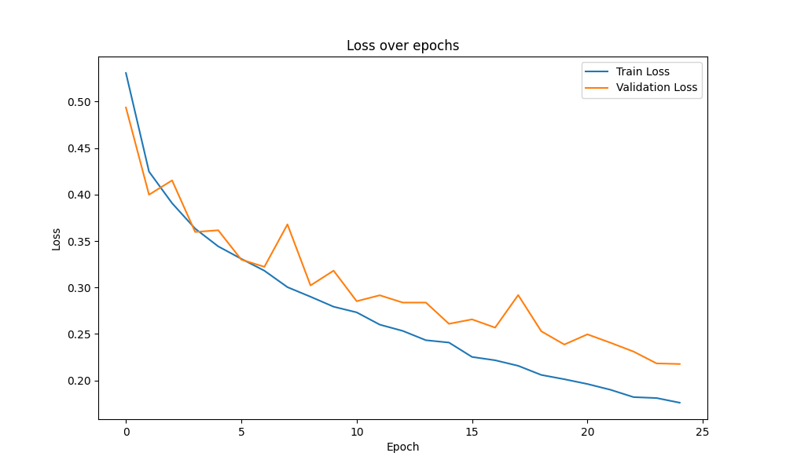

# Polyp and breast ultrasound segmentation

This repo trains U-Net and attention U-Net models in PyTorch to segment polyps in colonoscopy images from Kvasir-SEG and lesions in breast ultrasound images from the Breast Ultrasound Images (BUSI) dataset. Training and evaluation run in one Google Colab notebook, `Kvasir_example.ipynb`, which imports the models and the training loop from the Python files here.

## Data

**Kvasir-SEG** has 1,000 colonoscopy images with polyp masks annotated by hand and verified by a gastroenterologist ([dataset page](https://datasets.simula.no/kvasir-seg/)). A copy is committed under `Kvasir-SEG/Kvasir-SEG/`. The dataset terms allow research and educational use only. `train.txt` (880 image names) and `val.txt` (120 image names) list the split used for the reported Kvasir-SEG run.

**BUSI** has 780 breast ultrasound images in three classes, each with a lesion mask. BUSI is not in this repo. Download it from the [authors' page](https://scholar.cu.edu.eg/?q=afahmy/pages/dataset).

The notebook reads everything relative to `base_dir`, a Google Drive folder that holds this repo (`/content/drive/MyDrive/Thormed/Kvasir-SEG` in the notebook).

- Kvasir-SEG images go in `<base_dir>/Kvasir-SEG/images/` and masks in `<base_dir>/Kvasir-SEG/masks/`, with `train.txt` and `val.txt` in `<base_dir>`. The committed copy sits one level deeper, so move `Kvasir-SEG/Kvasir-SEG/` up a level or point `kvasir_dataset_dir` at it.
- BUSI goes in `<base_dir>/BUSI/Data/<class>/`, one folder per class (`benign`, `malignant`, `normal`), with the original file names such as `benign (1).png` and `benign (1)_mask.png`. When an image has more than one mask file, the notebook merges them into one mask.

Every image is resized to 256 x 256 and scaled to [0, 1]. Masks are resized and thresholded at 0.5.

| Dataset | How the split is made | Train | Validation | Test |
|---|---|---|---|---|
| Kvasir-SEG, reported run | `train.txt` and `val.txt` | 880 | 120 | none |
| Kvasir-SEG, current notebook | random, `random_state=42` | 720 | 80 | 200 |
| BUSI | random, `random_state=42` | 499 | 125 | 156 |

## Models

`models.py` builds each network through `UNet(arch=...)`.

- `"original"` is a U-Net. The encoder has four 2 x 2 max-pooling steps and grows from 64 to 1,024 channels. The decoder upsamples with transposed convolutions and concatenates the matching encoder features. Each block is two 3 x 3 convolutions, each followed by batch normalization and a ReLU (rectified linear unit). A 1 x 1 convolution and a sigmoid produce a one-channel mask.
- `"attention"` adds additive attention gates (Oktay et al., 2018) to the three deepest skip connections.
- `"nnunet"` is a variant inspired by nnU-Net that uses instance normalization and can return deep-supervision outputs. The repo has no results for it.

Training settings come from `train.py` and `config.py`.

| Setting | Value |
|---|---|
| Input | 256 x 256 color image |
| Batch size | 16 |
| Loss | binary cross-entropy (BCE) |
| Optimizer | Adam, learning rate 1e-4 |
| Learning-rate schedule | `ReduceLROnPlateau` on validation loss, factor 0.5, patience 5 |
| Epochs | 25 in `config.py`; the BUSI run set 40 |
| Checkpoint | lowest validation loss, saved as `best_model.pth` |
| Augmentation, training only | random horizontal and vertical flips, random rotation up to 15 degrees |

`unet.py` holds a standalone copy of the plain U-Net. `models.py` also defines a weighted BCE plus Dice loss (`BCEDiceLoss`) that the training loop does not use. `busidataset.py` holds an alternative BUSI dataset class that applies contrast-limited adaptive histogram equalization and speckle denoising before augmentation. The notebook does not use it.

## Results

Dice and intersection over union (IoU) are per-image means, with predictions thresholded at 0.5.

### BUSI, attention U-Net, held-out test set

The model trained for 40 epochs, with the checkpoint picked by lowest loss on the 125 validation images. The 156 test images played no part in training or checkpoint selection. These outputs are in the current `Kvasir_example.ipynb`, along with per-class Dice histograms and example predictions.

| Test images | Count | Dice | IoU |
|---|---|---|---|
| All | 156 | 0.632 | 0.557 |
| Benign | 86 | 0.718 | 0.629 |
| Malignant | 37 | 0.620 | 0.508 |
| Normal | 33 | 0.424 | 0.424 |

Normal images have empty masks, so the notebook scores each one as Dice 1 when the model predicts no lesion and close to 0 otherwise. That row measures false alarms. BUSI contains duplicate images ([Pawłowska et al., 2023](https://doi.org/10.1016/j.dib.2023.109247)), and this split is random by image, so some test images may have copies in the training set.

### Kvasir-SEG, U-Net, validation set

| Images | Dice | IoU |
|---|---|---|
| 120 (`val.txt`) | 0.714 | 0.607 |

These are validation numbers. The checkpoint was picked by lowest loss on these same 120 images, and this run had no separate test set.

The numbers come from the first version of the notebook ([commit c9e7458](https://github.com/HenryVu27/Polyps-Segmentation/blob/c9e7458289096359d513746dbe6836a24094ec8a/Kvasir_example.ipynb)), which trained for 25 epochs. `best_model.pth` holds that run's weights, from an earlier three-level U-Net rather than the one in `unet.py`.

Training and validation BCE loss over 25 epochs for the Kvasir-SEG U-Net run.

The repo does not include attention U-Net results on Kvasir-SEG or U-Net results on BUSI. The BUSI checkpoint is not committed either.

## How to run

1. Copy this repo to Google Drive and set `base_dir` in the notebook's first code cell to that folder.
2. Place the data as described under Data.
3. Open `Kvasir_example.ipynb` in Google Colab with a GPU (graphics processing unit) runtime and run section 1.
4. Run the Kvasir-SEG cells (2a and 3a) or the BUSI cells (2b and 3b).
5. Run section 4 to train. Set `arch` in `UNet(arch=...)` to pick the network. Training saves `best_model.pth` and `training_history.png` to `base_dir`. The `wandb.login()` cell is optional with this `train.py`.
6. Run section 5 to score the test split. The evaluation cell groups results by BUSI class, so it needs changes before it runs on Kvasir-SEG.

## Credits

### Datasets

- Jha, D., Smedsrud, P. H., Riegler, M. A., Halvorsen, P., de Lange, T., Johansen, D., and Johansen, H. D. (2020). Kvasir-SEG: A Segmented Polyp Dataset. International Conference on Multimedia Modeling, 451-462. [doi.org/10.1007/978-3-030-37734-2_37](https://doi.org/10.1007/978-3-030-37734-2_37)
- Al-Dhabyani, W., Gomaa, M., Khaled, H., and Fahmy, A. (2020). Dataset of breast ultrasound images. Data in Brief, 28, 104863. [doi.org/10.1016/j.dib.2019.104863](https://doi.org/10.1016/j.dib.2019.104863)

### Architectures

`models.py` cites the attention U-Net and nnU-Net papers.

- Ronneberger, O., Fischer, P., and Brox, T. (2015). U-Net: Convolutional Networks for Biomedical Image Segmentation. Medical Image Computing and Computer-Assisted Intervention. [arXiv:1505.04597](https://arxiv.org/abs/1505.04597)
- Oktay, O., et al. (2018). Attention U-Net: Learning Where to Look for the Pancreas. Medical Imaging with Deep Learning. [arXiv:1804.03999](https://arxiv.org/abs/1804.03999)
- Isensee, F., et al. (2018). nnU-Net: Self-adapting Framework for U-Net-Based Medical Image Segmentation. [arXiv:1809.10486](https://arxiv.org/abs/1809.10486)
